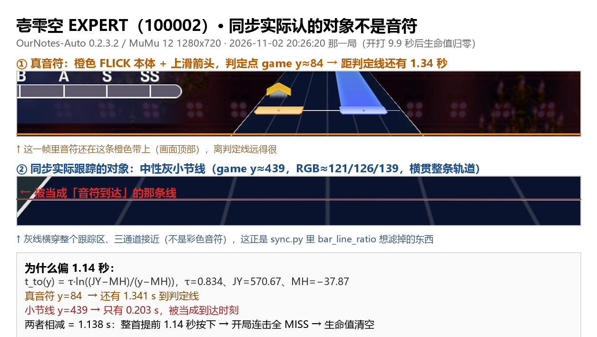

# 壱雫空 EXPERT（100002）每局提前约 1.1 秒下按，7~10 秒生命值归零：小节线采样点不足导致过滤被静默关闭

## 环境

| | |
|---|---|
| 版本 | OurNotes-Auto **0.2.3.2**（win-x64-MFAA 包，内嵌 Python 3.14.7） |
| 系统 | Windows 11 10.0.26100，i9-13900HX / 39.8 GB |
| 模拟器 | MuMu 12 6.8.7.0，实例 1，Android 15，1280×720 / 60fps，`device.touch=minitouch` |
| 游戏版本 | BanG Dream! 1.1.0 |
| 配置 | `game.difficulty=expert`、`loop.song_mode=list`、`loop.song_list=壱雫空`、`play.touch.great_ratio=0.0`、`jitter_ms=0`、`position_jitter=0`、`play.sync.record_frames=120` |

## 现象

**只有 100002 壱雫空 EXPERT（809 notes）这一首稳定出问题**，同一时段同配置打其他曲目没有异常。

- 同步日志看着完全正常：`同步成功 … 30~39 个样本 / 33~39fps / 外推误差 ±1.7~1.9ms / 残差 2~5ms`，`rms` 与 `sigma` 都远在门限（8.0 / 5.0）以内，**没有任何"存疑/失败"**。
- 但一开打就整首偏移：判定几乎全是 MISS（combo 长期为 0），**7~10 秒生命值归零**。
- 首局（`歌曲开始于 +5.1s`，带开场演出）和重试局（`歌曲开始于 -1.0s`，跳过演出）**都会死**，不是开局演出导致的。
- 该日志段（2026-11-02 20:14~20:26）里 26 次跑这一首，26 次归零；整份日志累计 75 次。

生命值归零瞬间的截图（附 `screenshots/死亡瞬间-20261102_202620.png`）：顶部 combo 停在个位数，判定线上方还有大量音符，说明是按得太早而不是没按。


*生命值归零瞬间（`debug/life/100002_expert_20261102_202620.png`）：combo 停在个位数，判定线上方还有大量音符未到 —— 是按早了，不是没按。*

## 根因

`player/sync.py` 里 `NoteTracker` 会挑一批横向位置作为「小节线采样列」，用来把横贯全屏的暗灰小节线从首音符候选中踢掉：

```python
_BAR_UNITS = np.arange(0.75, 23.5, 0.5)
_BAR_GAP = 1.5
_BAR_MIN_PROBES = 8
units = [u for u in _BAR_UNITS if all(u < s.left - _BAR_GAP or u > s.right + _BAR_GAP for s in spans)]
if params.bar_line_ratio > 0 and len(units) >= _BAR_MIN_PROBES:   # ← 不够就静默关闭
    ...
else:
    self._probe_y = self._probe_x = None                          # 什么都不记
```

100002 EXPERT 的首音符是两段宽度拉满的 span —— `first_hits()` 返回 `[0.0, 8.0]` 和 `[14.0, 22.0]`。两侧各让开 1.5 个单位后，`_BAR_UNITS` 里只剩 `9.75 / 10.25 / 10.75 / 11.25 / 11.75 / 12.25` **共 6 个**：

```
6 < 8  →  小节线过滤关闭  →  跟踪器把暗灰小节线当成了首音符
```

小节线的到达时刻比真音符早 **1.138 秒**，于是整个 `t0` 早 1.14s，plan 里所有按键都提前 1.1 秒发出 → 全 MISS → 数秒归零。而拟合本身是准的（残差 2~5ms），所以日志看不出异常。

## 证据

### 1. 死亡帧：跟踪到的到底是什么

从 `debug/sync/100002_expert_20261102_202620.npz` 的最后一帧（同步求解那一刻，`t=9335.293`）里，按几何反投影定位画面上的物体：

| 物体 | 位置 | 三通道 | 横向 | 距判定线 |
|---|---|---|---|---|
| 真音符（橙色 FLICK 本体+上滑箭头） | game y ≈ 42~84 | 橙 | 轨道内 | **1.341 s** |
| 被跟踪的对象 | game y ≈ 439 | **(139,126,121) 中性灰** | **横贯整条轨道，x 16~765 / 766** | **0.203 s** |

灰色、无彩色、横跨整个跟踪区——这就是 `bar_line_ratio` 想滤掉的小节线。`1.341 − 0.203 = 1.138 s`，与离线回放完全一致。标注图见 `screenshots/同步跟踪真相.png`。



*上：真音符（橙色 FLICK 本体+上滑箭头，game y≈84，距判定线 1.341 s）；下：同步实际跟踪的对象——横贯整条轨道的中性灰小节线（game y≈439，距判定线 0.203 s）。红线上方就是被当成「音符到达」的那条线。*

### 2. 同一份 dump 换门槛回放

用 `np.load` 重建 `NoteTracker`，逐帧喂 `crops`，只改 `_BAR_MIN_PROBES`：

| 门槛 | 跟踪到的对象 | samples | arrival (ms) | t0 (ms) |
|---|---|---|---|---|
| 8（现状） | 中性灰小节线 | 36 | 9335.491 | 9333.138 |
| 5（修改后） | 橙色 FLICK 本体下边缘（y 9.5 → 83.5，τ=0.829） | 32 | 9336.629 | 9334.276 |

**差值 +1138 ms**。

### 3. 影响面：全 376 张谱面只有 8 张会变

把 `cache/charts/charts.json` 里 376 张谱面全跑一遍「首音符让开 ±1.5 后还剩几个采样点」：

```
{0:10, 2:10, 4:2, 6:8, 8:2, 10:9, 12:5, 14:10, 16:7, 18:12,
 20:29, 22:2, 24:81, 28:126, 30:4, 32:56, 34:1, 36:2}

5~7 个：100002_expert, 100012_hard, 100021_expert, 100027_expert,
        100052_expert, 100061_expert, 100061_hard, 100061_normal   （全部是 6 个）
0~4 个：22 张（含 100111_expert）
```

- 门槛 8 → 5：只有上面这 **8 张**从「关闭」变成「开启」
- 0~4 个的 22 张保持关闭，行为不变
- 其余 346 张（≥8 个）本来就开启，`len(units) >= 5` 恒成立，行为不变
- 全库没有 5 个或 7 个的谱面，所以 5 和 6 今天等价，取 5 只是留余量

### 4. 已排除的假设：给 FLICK 加提前量没用

我先怀疑是「跟踪取 `max(亮的行号)` = 音符本体下边缘，FLICK 上滑箭头画在上方、永远选不中，所以前沿偏晚/偏早」，试过给 FLICK 开场加提前补偿（本地自改，非上游功能）。150 → 450 → 650 ms 三档，死亡时刻只是线性后移：

```
补偿 150ms → 死亡于 game_ms 7038
补偿 450ms → 死亡于 game_ms 7963
补偿 650ms → 死亡于 game_ms 9890
```

`误差 = 1.138s 根因 − 补偿量`，属于掩盖而不是修复；而且补偿值会被 planner 用在每颗 FLICK 的按下时刻上，越大越糟。**已全部回退为 0**，相关分支未混进下面的 patch。

## 修法

`play/sync.py`：门槛 8 → 5，并给「采样点不足」补一条 debug 日志，别再静默降级（静默是这个 bug 藏这么久的直接原因）。

```diff
-_BAR_MIN_PROBES = 8
+_BAR_MIN_PROBES = 5
```

完整 patch 见 `patch/fix-bar-line-probes.patch`（对 0.2.3.2 的 `ournotes_auto/player/sync.py`，已验证可正向/反向应用）。

另外建议（未改代码）：`bar_line_ratio` 的判定最好在样本点很少时也保留 —— 这条小节线横贯全宽、三通道接近，用 6 个点里 60% 亮就足以否决它，门槛其实不需要 8。

## 修后验证（同一台机器、同一配置）

2026-11-02 21:02~21:47 连打 18 局 100002 EXPERT：

| | 修复前 | 修复后 |
|---|---|---|
| 同步样本数 | 30~39 | **65~77（多数 73~77）** |
| 外推误差 | ±1.7~1.9 ms | **±1.13~1.23 ms** |
| 结果 | 26/26 局生命值归零 | **18/18 局 `P809 G0 B0 M0` / `COMBO 809`（AP/FC），无一归零** |

还有一个客观旁证：`debug/sync/*.npz` 里 `crops` 的宽度从 **766 变成 772** —— 右边多出来的 6 列正是被重新启用的采样列，说明小节线过滤确实开起来了。

> 小观察：修完后 FAST/SLOW 计数偏晚（例如 84 / 608），都在判定窗内、不影响 AP，只是供作者参考 offset 学习的方向。

## 附件

材料太多（含 7.2 MB 同步 dump、完整日志），都放在公开仓库里：

**https://github.com/tinsleymo33-lang/ournotes-auto-100002-evidence**

| 文件 | 内容 |
|---|---|
| [`tracked-object.png`](https://github.com/tinsleymo33-lang/ournotes-auto-100002-evidence/blob/master/tracked-object.png) | 上面那张标注图 |
| [`death-202620.png`](https://github.com/tinsleymo33-lang/ournotes-auto-100002-evidence/blob/master/death-202620.png) / [`death-194424.png`](https://github.com/tinsleymo33-lang/ournotes-auto-100002-evidence/blob/master/death-194424.png) | `debug/life/` 归零瞬间原图 |
| [`before-fix-excerpt.log`](https://github.com/tinsleymo33-lang/ournotes-auto-100002-evidence/blob/master/before-fix-excerpt.log) | 修复前 26 次归零的连续日志（20:14~20:26） |
| [`after-fix-excerpt.log`](https://github.com/tinsleymo33-lang/ournotes-auto-100002-evidence/blob/master/after-fix-excerpt.log) | 修后 18 局 AP 的同步日志（21:02~21:47） |
| [`ournotes.log`](https://github.com/tinsleymo33-lang/ournotes-auto-100002-evidence/blob/master/ournotes.log) | 完整日志 |
| [`sync-dump-202205.npz`](https://github.com/tinsleymo33-lang/ournotes-auto-100002-evidence/blob/master/sync-dump-202205.npz) | 出事那局的同步 dump（`crops`/`times`/`box`/`spans`/`first_ms`/`arrival`，120 帧），可照下面第 3 步直接回放 |
| [`evidence.json`](https://github.com/tinsleymo33-lang/ournotes-auto-100002-evidence/blob/master/evidence.json) | 上面所有回放数值、几何常量、采样点分布 |
| [`fix-bar-line-probes.patch`](https://github.com/tinsleymo33-lang/ournotes-auto-100002-evidence/blob/master/fix-bar-line-probes.patch) | 修法补丁（已验证可正/反向应用到 0.2.3.2） |

## 复现步骤

1. `play.sync.record_frames: 120`，`game.difficulty=expert`，歌单只放 壱雫空（100002）
2. 跑到 `生命值归零`，拿 `debug/sync/100002_expert_<ts>.npz`
3. 用 dump 分别以 `_BAR_MIN_PROBES=8 / 5` 回放，比较 `arrival`（`sync-dump-202205.npz` 就是现成的样本，回放脚本见仓库 README）
4. 或直接看日志里的 `同步成功 … N 个样本`：**N 在 30~39 且这首曲子必死 → 命中本 bug；N 在 65~77 才正常**
